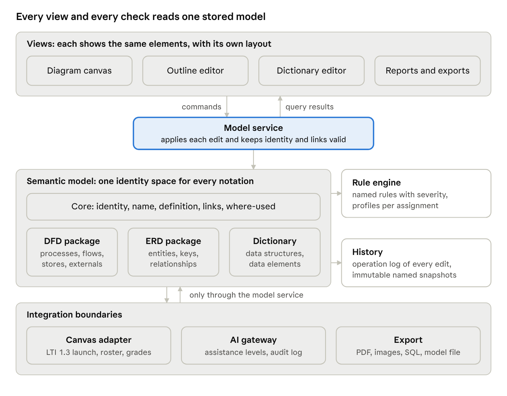
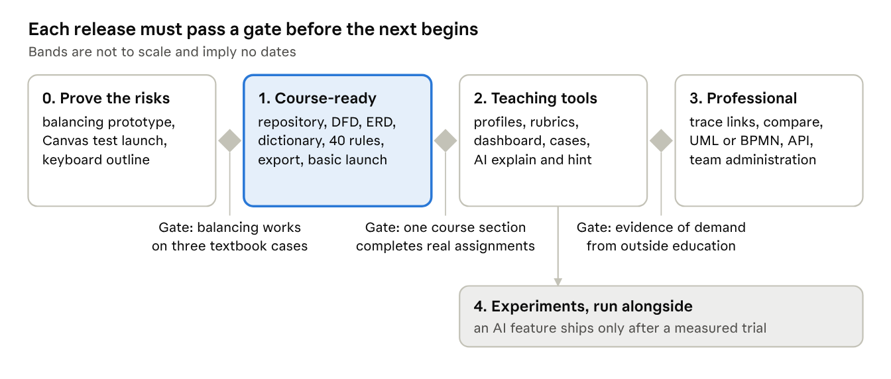

# Diagramble: Research and Product Vision for a Modern Systems Analysis and Design Platform

17 November 2026 · Todd Whittaker

Exported from the [working document](https://claude.ai/artifact/V3iHstjFm3RjyJhZnpGRg1) at revision 39.

## 1. Executive summary

Build a small web tool that keeps one model behind every diagram, checks that model against explicit rules, and explains each violation in plain words. That is the part of Visible Analyst that matters, and no free or web-based tool offers it.

"Diagramble" is used below as the working name. CASE means Computer-Aided Software Engineering. DFD means data flow diagram. ERD means entity relationship diagram.

### Key findings

1. **The gap is real and narrow.** About 30 tools were researched. Only three document a check that a child DFD balances with its parent: Visible Analyst, SAP PowerDesigner and Unicom System Architect. All three are Windows desktop products. No web tool and no open-source tool does it.
2. **Visible Analyst's value is its repository and its Analyze function, not its drawing.** Every diagram object gets a repository entry, and Analyze checks syntax, balancing, keys and the fit between the data model and the process model. Its weaknesses are Windows-only delivery, a rule set fixed at project creation, and no visible release notes.
3. **Free diagram tools win on access and lose on meaning.** Lucidchart, draw.io and Miro need no install and cost students nothing. In all of them a process is only a circle, and nothing checks it.
4. **DFDs are still taught.** The current Dennis, Wixom and Roth (8th edition) and Kendall and Kendall (11th edition) textbooks each keep a full DFD chapter. Both have added agile and object-oriented material beside it, not in place of it.
5. **Unguarded AI harms learning, and AI grading is not reliable enough to run alone.** In one field experiment, students who practiced with plain GPT-4 scored 17% lower on a later unassisted exam than students who never had it. A guarded tutor largely removed that harm.
6. **Nothing open source is a ready foundation.** Permissive libraries cover the canvas, layout and export. The semantic model, the rule engine and the data dictionary must be purpose-built.
7. **Accessibility is a legal requirement and a design advantage.** Public universities must meet the Web Content Accessibility Guidelines (WCAG) 2.1 Level AA by April 2027 or April 2028. When diagrams are views of a model, an outline view of the same model is a natural keyboard and screen-reader path.
8. **The project is open source and not a business.** Its lasting value is the rule library, the explanations and the teaching content, which anyone can reuse and improve. The open questions are who hosts it and who maintains it.

### Strongest recommendation

Build first a single-user web application with five parts: a repository, leveled DFDs, crow's-foot ERDs, a data dictionary, and about 40 deterministic rules with explanations. Add PDF export and a Canvas launch through Learning Tools Interoperability (LTI) 1.3.

Do not build Unified Modeling Language (UML) diagrams, Business Process Model and Notation (BPMN), code generation, real-time collaboration or AI diagram generation in the first release. Each one adds breadth without adding the consistency checking that justifies the product.

### Answers to the research questions

| Question | Short answer | Section |
| --- | --- | --- |
| What made traditional CASE tools valuable? | A shared repository, enforced notation rules, balancing, and output derived from the model | 4 |
| Which features remain relevant? | Repository, dictionary, balancing, data-to-process checks, key analysis, generated documentation | 3 |
| What limits existing tools for undergraduates? | Windows-only installs, heavy interfaces, cost, or no semantics at all | 2 |
| What separates a CASE tool from a diagram editor? | Element identity outside diagrams, typed connections, cross-diagram rules, where-used | 4 |
| How do leading tools keep models consistent? | One element with many diagram occurrences, plus a rule check run over the repository | 4, 7 |
| What do web, collaboration and AI advances enable? | Zero install, instant rule feedback, version history, guarded explanation and questioning | 7, 8 |
| What does excellent teaching look like? | Guided steps, feedback that says why, assignment profiles, rubric-linked review | 5 |
| What gives value beyond academia? | Traceability, schema generation, team repositories, model review | 6, 10 |

## 2. Competitive landscape

No product combines browser delivery, a shared model, DFD balancing and a price a student can pay. The tools that check DFDs are enterprise desktop products, and the tools students can reach do not check anything.

Each cell reflects vendor documentation read on 17 November 2026 unless marked. "Not found" means the documentation was searched and showed no such feature. It is not proof of absence. "Unverified" means the claim could not be confirmed from a primary source.

### Traditional CASE and professional modeling tools

| Product | Notations | Model or drawing | Dictionary and consistency checks | Platform and collaboration | Education terms and price |
| --- | --- | --- | --- | --- | --- |
| [Visible Analyst](https://www.visiblesystemscorp.com/Products/Analyst) | DFD in four rule sets, ERD, structure charts, functional decomposition, six UML diagram types; BPMN claimed | Shared repository | Full data dictionary. Analyze checks syntax, balancing, keys, and data model against process model | Windows only. Multi-user claimed | [Student token $49 for six months](https://www.visiblesystemscorp.com/Solutions/edu_price.htm); classroom tokens $49 down to $19.95 |
| [SAP PowerDesigner](https://infocenter.sybase.com/help/topic/com.sybase.infocenter.dc38088.1652/doc/html/rad1232026266129.html) | DFD in Gane and Sarson or Yourdon style, conceptual to physical data models, UML, BPMN | Shared within a model; shortcuts across diagrams | Documented DFD balancing under Check Model. Data objects link to data models | Windows only. Enterprise repository with check-in | No public price or academic program found. Development reported as stopped (unverified) |
| [Unicom System Architect](https://support.unicomsi.com/manuals/systemarchitect/11482/Architecting_and_designing/StructuredAnalysisDesign.18.040.html) | Yourdon DFD, data models, enterprise frameworks | Shared repository | Balance Parent, Balance Child and Auto-Balance. Balancing expands dictionary structures down to elements | Windows only | No public price or academic terms found |
| [Sparx Enterprise Architect](https://sparxsystems.com/enterprise_architect_user_guide/17.1/guide_books/tools_ba_data_flow_diagram.html) | DFD, UML, BPMN, SysML, ArchiMate, data models | Shared repository | Project glossary, not a typed dictionary. No DFD balancing check found | Windows client; file, database or cloud repository; [baselines and compare](https://sparxsystems.com/enterprise_architect_user_guide/16.1/modeling_fundamentals/managingbaselines.html) | [Academic seat from about 115 euros](https://www.sparxsystems.eu/?p=5262) (undated) |
| [Visual Paradigm](https://www.visual-paradigm.com/support/documents/vpuserguide/285/2145/56977_creatingdata.html) | DFD in four styles, ERD, UML, BPMN, SysML, ArchiMate | Shared model on desktop | Glossary. [Decompose copies parent flows to the child](https://www.visual-paradigm.com/tutorials/in-out-flows.jsp). No balancing check found in the user guide | Desktop plus Visual Paradigm Online; Teamwork Server | [Academic program $1,250 to $5,000 per department per year](https://www.visual-paradigm.com/partner/academic/), with class-size and training-hour minimums |
| [IBM Rhapsody](https://www.ibm.com/products/systems-design-rhapsody) | UML, SysML, AUTOSAR. No DFD or ERD | Shared model | Requirements traceability (claimed). Not relevant to structured analysis | Desktop | No student license found |
| [erwin Data Modeler](https://bookshelf.erwin.com/bookshelf/public_html/12.5/Content/Release%20Notes/Data%20Modeler%20Release%20Notes/erwin%20Data%20Modeler%20Editions.html) | Data models only | One model, many views | Model and database comparison. No DFD | Windows; Mart server | No public price |
| [Astah Professional](https://astah.net/products/compare-editions/) | DFD in two styles, ERD, UML, CRUD tables | Not confirmed | No balancing documented | Desktop (Java) | [Free student license covers the UML edition only](https://astah.net/products/academic-discount-license/); Professional academic $48 |
| [StarUML](https://staruml.io/pricing) | UML, ERD, DFD, flowcharts | Not confirmed for DFD | No balancing documented | Desktop | $159 per device, 30% education discount |
| [Software Ideas Modeler](https://www.softwareideas.net/dfd-data-flow-diagram) | DFD in two styles, ERD, UML, BPMN | Not confirmed | No DFD rules documented | Windows | Standard edition free for non-commercial use |

### Web-based diagramming and diagrams as text

| Product | Notations | Model or drawing | Dictionary and consistency checks | Platform and collaboration | Education terms and price |
| --- | --- | --- | --- | --- | --- |
| [Lucidchart](https://lucid.co/diagram/dfd/tutorial) | DFD shapes and templates, [ERD with SQL import and export](https://help.lucid.co/hc/en-us/articles/16471565238292-Create-an-Entity-Relationship-Diagram-in-Lucidchart) | Drawing | None. Its DFD rules are a manual checklist | Browser, real-time editing. [Canvas assignments graded in SpeedGrader](https://help.lucid.co/hc/en-us/articles/14559937492756-Integrate-Lucid-with-Canvas) | [Free education account](https://lucid.co/lucidchart/education) |
| [draw.io](https://www.drawio.com/docs/diagram-types/data-flow-diagrams/) | DFD shape library, ERD shapes, SQL insert | Drawing | None | Browser and desktop. Real-time editing only on certain storage | Free; source under Apache 2.0 |
| [Miro](https://miro.com/diagramming/data-flow-diagram/) | DFD and ERD shape packs | Drawing | None | Browser, strongest real-time collaboration | Free education plan (limits unverified) |
| [Mermaid and Mermaid Chart](https://mermaid.js.org/syntax/entityRelationshipDiagram.html) | About 20 text-defined types, including ER. No DFD type | One text block per diagram | Syntax errors only | Library renders anywhere; [paid editor](https://mermaid.ai/pricing) | Library MIT; editor $0 to $20 per user per month |
| [PlantUML](https://plantuml.com/ie-diagram) | UML, ER in two notations. No DFD type | One text file per diagram | Syntax errors only | Renders through plugins and servers | Free; GPL and other variants |
| [dbdiagram.io](https://dbdiagram.io/pricing) | ERD from text, SQL import and export | One schema | None beyond syntax | Browser | Free tier; free Pro for students for 12 months |
| [ERDPlus](https://erdplus.com/) | ERD in Chen or crow's foot, relational schema, star schema | Drawing with a one-click conversion to a relational schema | Not documented | Browser | Free; no license stated |
| [Structurizr](https://docs.structurizr.com/) | C4 software architecture only | One model, many views, defined in text | Validate and inspect commands (scope unverified) | Browser and local | Open-source Lite edition |

### Open-source and specialized tools

| Product | Notations | Model or drawing | Dictionary and consistency checks | Platform and collaboration | License and status |
| --- | --- | --- | --- | --- | --- |
| [Papyrus Web](https://eclipse.dev/papyrus/papyrus-web.html) | UML only | Shared UML model | Not documented for the web version | Browser, real-time editing | EPL-2.0; release 2026.05.0 |
| [Modelio](https://github.com/ModelioOpenSource/Modelio) | UML, BPMN, ArchiMate | Shared model | Live audit rules | Desktop | GPL-3.0; 6.2.0 in August 2026 after a gap of over two years |
| [Gaphor](https://docs.gaphor.org/en/latest/) | UML, SysML, C4 | Shared UML model | None found | Desktop (Python, GTK) | Apache-2.0; 3.3.2 in May 2026 |
| [DBeaver](https://dbeaver.com/docs/dbeaver/24.2/ER-Diagrams/) | ERD of an existing database | View of live database metadata | None at model level | Desktop; CloudBeaver on the web | Apache-2.0; fortnightly releases |
| [pgModeler](https://github.com/pgmodeler/pgmodeler) | PostgreSQL physical schema | Shared model | Validation of broken references | Desktop | GPL-3.0; 2.0.0 in October 2026 |
| [bpmn.io](https://bpmn.io/license/) | BPMN, decision tables, forms | Model and layout in one standard XML file | Modeling rules while drawing, plus [bpmnlint](https://github.com/bpmn-io/bpmnlint) rule sets | Browser library | Custom license with a mandatory watermark; very active |
| [Sirius Web and SysON](https://docs.obeosoft.com/sirius-web/user-manual/features/diagram.html) | Any notation you define; SysML v2 in SysON | Diagrams are views of a semantic model | Limited in web documentation | Browser; Java and PostgreSQL server | EPL-2.0; release 2026.11.1 |
| [Apollon and Artemis](https://docs.artemis.tum.de/instructor/exercises/modeling-exercise/) | UML and BPMN for teaching. No DFD or ERD found | Diagram data | Assessment support, not notation rules | Browser | MIT; Apollon 5.5.0 in October 2026 |
| [OWASP Threat Dragon](https://github.com/OWASP/threat-dragon) | Threat-model DFD | Diagram data | Threat rules, no leveling or balancing | Browser and desktop | Apache-2.0; 2.6.2 in May 2026 |

### What the matrix shows

- **Balancing is rare.** Only Visible Analyst, PowerDesigner and System Architect document it. System Architect's design is the best: it balances through the data dictionary, so a parent flow can match two child flows that together compose it.
- **Reachable tools are drawing tools.** Every free or browser product above treats a DFD as shapes. Lucidchart's own tutorial lists the DFD rules as a checklist for the reader to apply by hand.
- **ERDs are better served than DFDs.** Several tools import or generate SQL. Nothing comparable exists for DFDs.
- **Shared-model designs exist on the web, but not for this subject.** Structurizr, Sirius Web and bpmn.io each prove the approach for another notation.
- **Every commercial web tool now generates diagrams with AI.** Controls to turn it off exist only on some plans, so instructors cannot rely on them.

### Evidence limits

- Sparx documentation blocked automated reading, so Enterprise Architect details rest partly on search snippets.
- No public reviews, release notes or version number were found for the current Visible Analyst.
- Creately, Gliffy, SmartDraw and Visio for the web were not researched in depth.

## 3. Visible Analyst capability inventory

Preserve the repository, decomposition, balancing and the data-to-process checks. Redesign how feedback is delivered. Abandon structured design, code generation and most of the extra diagram types.

The detail below comes from two documents: the [Operation Manual for version 7.6](https://www2.rivier.edu/faculty/vriabov/VA-7-6-manual.pdf) (copyright 2002) and the vendor's [Entity Relationship and Data Flow Tutorial](https://resources.visiblesystemscorp.com/hubfs/VA%20Tutorial%20ERD%20and%20Dataflows.pdf) (copyright 2008 to 2020). Neither names the current version. Anything newer rests on vendor web pages only.

### Current status

- **Platform:** Windows only. The [instructor page](https://www.visiblesystemscorp.com/Solutions/instructor.htm) lists Windows Vista through Windows 10 and does not mention Windows 11.
- **Development activity:** unverified. No release notes, version number or release date appears on any vendor page that could be read.
- **Editions (vendor claim):** Student, Professional, Enterprise Framework and a 90-day Community edition.
- **Web version:** none for modeling. The vendor mentions a cloud server for assignment hand-in and a browser "Model Repository Viewer" for instructors.
- **Textbook ties:** the vendor lists Kendall and Kendall editions 7 to 10. The 11th edition's publisher page does not mention Visible Analyst.
- **Independent reviews:** none found. No student or instructor complaints could be located, so usability criticisms here are inferences from the documentation.

### Capability by capability

| Capability | What Visible Analyst does | Treatment | Reason |
| --- | --- | --- | --- |
| DFD rule sets | Four: Yourdon/DeMarco, Gane and Sarson, SSADM, Métrica. Chosen at project creation and cannot be changed | Redesign | The four differ mainly in symbol shapes. Store one DFD model and make the symbol style a display setting. Drop SSADM and Métrica |
| Context diagram | One process only; flagged as the context diagram | Preserve | It is the first rule students learn and it is cheap to check |
| Decomposition ("Explode" or "Nest") | Creates a child diagram and drags the parent's flows down, inputs left and outputs right | Preserve and modernize | This is the core of leveled DFDs. Add breadcrumb navigation and a visible boundary for inherited flows |
| Process numbering | Numbers follow the hierarchy (1, 1.1, 1.1.1). Analyze flags unnumbered processes | Preserve, automate | Numbering by hand is busywork. Assign it automatically |
| Split data flow | A parent flow can be split into subflows on the child. The link is kept in the repository so balancing still passes | Redesign | Drive this from the dictionary instead of a dialog. If "Order" is defined as "Customer Details + Order Lines", those two child flows balance with it |
| Repository entries | Every diagram object gets an entry automatically. Fields include description, alias, composition, values and meanings, notes | Preserve | This is what makes it a CASE tool |
| Location ("where used") | Lists every diagram and every parent structure that uses an entry | Preserve | Students cannot get this from a drawing tool. It is the basis of impact analysis |
| Composition field | A list of component names; a free-form field in the "Classic User Interface" | Modernize | Offer a structured editor with a text view. The classic notation with plus signs, brackets and braces was not found in either document |
| Rename | Allowed only when the item is on no diagram and in no composition. A "Rebuild" tool resynchronizes diagrams and repository | Redesign | A rename should happen once and show everywhere. A rebuild tool should not be needed |
| Analyze: syntax and connections | Unnamed or unnumbered processes, dangling objects, input-only or output-only processes, flows not attached to a process | Preserve rules, redesign delivery | Run them as the student works. Each message should say why and how to fix it |
| Analyze: balancing | A net input or output on a parent must keep its direction at every lower level. Flows labeled "Error" or "Reject" and local file flows are exempt | Preserve | The name-based exemption is a hack. Replace it with an explicit "local to this level" marking |
| ERD notations | Crow's foot, arrow, Bachman, IDEF1X. Chen diamonds not found | Modernize | Crow's foot by default. Add Chen later if database courses ask. Drop arrow and Bachman |
| Entity types | Fundamental, associative, attributive; subtypes with discriminators | Preserve | Matches what the textbooks teach |
| Normalization checks | Flags many-to-many relationships, optional-both-ways relationships, one-to-one mandatory relationships | Preserve | Clear, checkable rules. Make severity configurable per assignment |
| Key Analysis | Entity without a primary key; primary key with no matching foreign key; foreign key with no relationship | Preserve | Missing keys are a common student error |
| Key Synchronization | Migrates primary keys across relationships to create foreign keys | Preserve, make visible | Show the proposed foreign keys and let the student accept them. Doing it silently hides the lesson |
| Model Balancing | Two options: every entity must correspond to a data store, and every fundamental element must be used on a DFD | Preserve | This is the signature cross-model check. Add a matrix of processes against entities |
| Data model views | A "process view" builds an ERD from the entities used by one process | Defer | Useful, but not needed for a first course |
| SQL schema generation | CREATE TABLE, CREATE INDEX and comments in many dialects. Education editions limited to Access and Oracle | Modernize, later | One or two dialects is enough. It shows students that a model produces something real |
| Reverse engineering and schema comparison | Reads a database through ODBC and compares model with schema | Abandon for education | Not part of an analysis course. Revisit as SQL import at the professional level |
| Structure charts | Yourdon/Constantine charts; can be generated from the repository | Abandon | Structured design has left most curricula |
| Shell code generation | Program skeletons in C and COBOL | Abandon | No curriculum value today |
| Functional decomposition diagrams | A diagram type that can spawn child DFDs | Derive | Show the process hierarchy as a tree generated from the DFD levels. Do not make it a separate editor |
| UML diagrams | Class, state, use case, sequence, collaboration, activity | Defer | Add use case diagrams first, at Level 2 |
| BPMN, Zachman framework, entity life history, PERT, organization charts | Listed by the vendor or the 2002 manual | Abandon | Breadth without consistency checking |
| Planning statements | Typed, prioritized statements that link to repository objects | Redesign, later | Becomes requirements with traceability at Level 2 |
| Reports | Detailed and summary listings, cross-reference, split flow listing, business rules report, custom queries | Modernize | One generated project document, plus a dictionary export to a spreadsheet |
| Project tools | Backup, restore, copy, rebuild, project history | Redesign | Automatic version history and named checkpoints replace all of these |
| Multi-user editing | Locking and access rights on a local network version | Defer | See the collaboration assessment in section 13 |
| Assignments | Instructors create assignments and students submit to a vendor cloud server (vendor claim) | Modernize | Replace with LTI so it works inside the learning management system |

### What Visible Analyst provides versus what a course needs

| A current course needs | Visible Analyst today |
| --- | --- |
| Access from any laptop, including Macs and Chromebooks | Windows install with a license token |
| Feedback while modeling, in language a beginner understands | Analyze is run on demand and returns terse messages such as "Net input data flow 'x' is not shown attached to parent process" |
| Assignments scoped to what has been taught so far | One rule set per project, fixed at creation |
| Hand-in and grading inside Canvas | A separate vendor cloud server |
| Evidence of process for academic integrity | Project history only |
| Agile and object-oriented material beside structured analysis | Present as separate diagram types with their own rules |
| Accessibility conformance | No accessibility statement found |

### What students miss when they use a drawing tool

- A flow named "Order" on two diagrams is one thing with one definition. A drawing tool lets the two drift apart.
- A child diagram must account for every flow of its parent process. A drawing tool cannot know which diagram is the parent.
- A data store should correspond to entities, and the data in flows should be attributes that exist. A drawing tool has no data model to compare against.
- Renaming or deleting something has consequences elsewhere. A drawing tool has no "where used".

## 4. Essential CASE capabilities

A CASE tool knows what each shape means and holds that meaning outside any one diagram. A diagram editor knows only where each shape sits. Eight capabilities follow from that difference.

| Capability | What it means | How to test a tool for it | Evidence from existing tools |
| --- | --- | --- | --- |
| 1. Element identity outside diagrams | One process, entity or flow exists once in the model and can appear on many diagrams | Rename it on one diagram. Does it change on the others? | Enterprise Architect separates [removing from a diagram and deleting from the model](https://sparxsystems.com/enterprise_architect_user_guide/16.0/deletingobjects.htm). Sirius Web has the same two commands |
| 2. Typed elements and connections | The tool knows a process from a data store and refuses or flags connections the notation forbids | Draw a flow from one data store to another. Does anything object? | bpmn.io enforces modeling rules while drawing. Drawing tools accept any line |
| 3. Repository and data dictionary | Every element has a definition, and data definitions are built from other definitions | Ask what data is inside a flow. Is the answer structured? | Visible Analyst's composition and alias fields. Glossaries in Enterprise Architect and Visual Paradigm are word lists, not typed definitions |
| 4. Decomposition with balancing | A process expands into a child diagram, and the two must agree | Remove a flow from the child. Is the mismatch reported? | Documented in Visible Analyst, PowerDesigner and System Architect only |
| 5. Cross-model consistency | Different kinds of model are checked against each other | Add an entity that no data store uses. Is it reported? | Visible Analyst's Model Balancing. The Dennis textbook teaches [balancing ERDs with DFDs](https://www.wiley.com/en-us/Systems+Analysis+and+Design,+8th+Edition-p-9781119803799) |
| 6. Where-used and impact | The tool can list every place an element appears and what depends on it | Ask what breaks if an attribute is deleted | Visible Analyst's Location field. Traceability matrices in Enterprise Architect and PowerDesigner |
| 7. Derivation from the model | Reports, schemas, matrices and child diagram skeletons are generated, not redrawn | Generate a dictionary report. Does it match the diagrams without manual work? | Schema generation in Visible Analyst, PowerDesigner, erwin. ERDPlus converts an ERD to a relational schema |
| 8. Configurable rule sets | Rules are named, have severity, and can be switched per project | Turn one rule off for one project | [bpmnlint](https://github.com/bpmn-io/bpmnlint) presets and per-rule overrides. Visible Analyst's balancing options |

### How the leading tools keep models consistent

They use the same two mechanisms, and neither is exotic.

1. **One stored element, many diagram occurrences.** Consistency of names and definitions is then automatic, because there is only one copy. This is why a rename test separates the two classes of tool so cleanly.
2. **A rule check run over the repository.** PowerDesigner calls it Check Model. Visible Analyst calls it Analyze. bpmn.io splits it into rules enforced while drawing and lint rules run afterwards. Rules are queries over the stored model, not over the picture.

The best balancing design found is System Architect's. Flows with the same name match directly. Flows with different names are expanded through their dictionary structures down to elements and compared there. A structure that has no element definition cannot be balanced, which forces the student to define the data.

### What this implies for the product

- Capabilities 1 to 3 are the foundation and must be right in the first release. They cannot be added to a drawing tool afterwards.
- Capabilities 4 to 6 are rules and queries over that foundation. They can grow release by release.
- Capabilities 7 and 8 are where modern delivery adds value: instant reports, and rule profiles an instructor can set per assignment.

## 5. Educational opportunity

The teaching advantage is feedback that arrives while the student is modeling and says why something is wrong. The instructor advantage is that structural grading is done before the submission is opened.

### Student workflow

1. Open the assignment from Canvas. The project opens in the browser with the case description beside the canvas. There is no install and no separate login.
2. Follow the guided first step: name the system and its external entities. The tool creates the context diagram.
3. Add flows. Each flow asks for a name and offers to define its contents in the dictionary.
4. Expand a process. The child diagram opens with the parent's flows already on its boundary.
5. Watch the problems panel. Each problem names the rule, explains why it matters, and points to the elements involved.
6. Build the ERD. Data stores link to entities, and dictionary elements link to attributes.
7. Run the full check, fix what remains, and submit. A snapshot is stored and a score for the checkable rubric rows goes to the gradebook.
8. Read the instructor's comments on the model, revise, and resubmit if the assignment allows it.

### Instructor workflow

1. Create the assignment from Canvas and pick a case, or write one.
2. Choose an assignment profile: which notations, which constructs, which rules, how severe each rule is, and how much AI help is allowed.
3. Optionally attach a starter model, such as a finished context diagram.
4. Watch the class dashboard: who has started, which rules are failing most often, who is stuck.
5. Open a submission. Checkable rubric rows are already scored. Judge the rows that need judgment, and attach comments to specific elements.
6. Reuse a comment on other submissions that show the same issue.
7. Release grades to Canvas. Allow resubmission where wanted.

### Core engine versus instructional scaffolding

Keeping these apart matters. The core must be correct for any user, including a professional. Scaffolding is a layer that can be switched off.

| Capability | Belongs to | Note |
| --- | --- | --- |
| Semantic model, repository, dictionary | Core | Same for every user |
| Rule engine with severity and rule profiles | Core | A profile is data, so an instructor profile and a professional profile use one mechanism |
| Rule explanations ("why" and "how to fix") | Core | Professionals benefit too. The wording level can vary by profile |
| Decomposition, balancing, where-used | Core |  |
| Version history and snapshots | Core | Submissions are named snapshots |
| Guided workflows and first-run steps | Scaffolding | Driven by the assignment profile |
| Symbol and rule glossary, context help | Scaffolding | Content, not engine |
| Restricting notations and constructs | Scaffolding built on a core feature | The palette is filtered by the profile |
| Starter projects and case studies | Scaffolding | Content library |
| Rubrics, dashboards, comments, resubmission | Scaffolding | Instructor module |
| Learning management system launch and grade return | Integration | Separate boundary from both |
| AI assistance levels | Scaffolding | Enforced by the server, set in the profile |

**Should an instructor be able to restrict notations, constructs and rules per assignment?** Yes. It is the cheapest high-value teaching feature, because the rule engine already needs named rules with severity. Week 2 can allow only a context diagram. Week 5 can turn on balancing. The research on novices supports limiting what is on screen: worked examples and reduced choice help beginners, and [the benefit fades as skill grows](https://faculty.engineering.asu.edu/mre/wp-content/uploads/sites/31/2020/02/Exp_Rev_LI06.pdf).

### What software can check and what needs judgment

| Checkable by rules | Needs a person, or AI as an assistant |
| --- | --- |
| Process with inputs but no outputs, or outputs but no inputs | Whether the outputs could plausibly come from the inputs |
| Flow that does not touch a process | Whether names are meaningful |
| Unnamed or duplicate elements | Whether the right processes and entities were found in the case |
| Child diagram out of balance with its parent | Whether the level of decomposition is sensible |
| Data store only written or only read | Whether a cardinality matches the business rule |
| More than one process on the context diagram | Whether something should be an entity or an attribute |
| Entity without a primary key; relationship without cardinality | Normalization quality beyond mechanical tests |
| Many-to-many relationship left unresolved, when the profile requires it | Whether the model answers the case |
| Data store with no matching entity; flow contents not defined | Whether an alternative correct solution is acceptable |

The left column is scored automatically. The right column stays with the instructor. Research on automated graders shows why: tools that match against a reference solution [over-penalize valid alternatives](https://www.scitepress.org/publishedPapers/2025/134819/pdf/index.html).

Entity relationship misconceptions are well documented. In [one study of 200 final exams](https://www.frontiersin.org/journals/education/articles/10.3389/feduc.2025.1554089/pdf), 60% of students mixed two notations in one model and 30% misplaced cardinality symbols. The tool prevents the first by construction and can flag the second. No comparable frequency study was found for DFD errors, so the DFD rule list rests on textbooks and on [one published formalization](https://arxiv.org/abs/1011.0278).

### Assessment

- **Rubric rows map to rules or to judgment.** A row such as "all levels balance" is tied to rule results and scores itself. A row such as "processes are well chosen" is scored by the instructor.
- **Comments attach to model elements,** not to pixel positions, so they survive a rearranged diagram and a resubmission.
- **Reusable comments** follow the pattern in Gradescope and Artemis: write once, apply to every submission with the same issue.
- **Resubmission** compares two snapshots and shows which rule results changed.
- **Portfolios** are exports: a project document with diagrams, dictionary and check results, as a PDF.

### Canvas through LTI 1.3

| Service | What it does for this product |
| --- | --- |
| [LTI 1.3 launch](https://www.imsglobal.org/spec/lti/v1p3/) | Canvas signs the user in and passes their role and course. No separate account |
| [Deep Linking 2.0](https://www.imsglobal.org/spec/lti-dl/v2p0) | The instructor configures the assignment inside the tool. Canvas creates the gradebook column |
| [Assignment and Grade Services 2.0](https://www.imsglobal.org/spec/lti-ags/v2p0/) | The tool posts a score, a status and a comment |
| [Names and Role Provisioning 2.0](https://www.imsglobal.org/spec/lti-nrps/v2p0) | The tool reads the roster for the dashboard |

Two Canvas details are uncertain and need a sandbox prototype early. How SpeedGrader displays an external tool's submission depends on what the tool returns. The newer [Asset Processor placement](https://developerdocs.instructure.com/services/canvas/external-tools/lti/file.document_processor) handles submitted files, so it suits a report on an exported document more than live modeling.

### Accessibility and keyboard modeling

- **Legal position.** The Department of Justice rule under Title II of the Americans with Disabilities Act requires public universities to meet WCAG 2.1 Level AA. An [interim rule of April 2026](https://campustechnology.com/articles/2026/04/27/doj-extends-deadline-for-ada-title-ii-compliance.aspx) moved the dates to 26 April 2027 for larger entities and 26 April 2028 for smaller ones. Vendor tools are not exempt.
- **Design position.** WCAG 2.2 adds a rule that [every drag action needs a non-drag alternative](https://www.w3.org/WAI/standards-guidelines/wcag/new-in-22/). A drag-only canvas fails it.
- **Approach.** Provide an outline view where every element and connection is a list item that can be created, edited and connected from the keyboard. The canvas is one view of the model and the outline is another. Research prototypes for blind users take the same route: a structured text alternative, not an audio canvas.
- **Procurement.** Publish an Accessibility Conformance Report, the completed form of the Voluntary Product Accessibility Template.

### Institutional adoption requirements

- **Student records.** United States universities share student records with vendors under a "school official" arrangement that needs a written agreement and limits use of the data. The exact regulatory text was not verified in this research.
- **Security review.** Campuses usually ask for the [Higher Education Community Vendor Assessment Toolkit](https://www.educause.edu/higher-education-community-vendor-assessment-toolkit) questionnaire, and for larger purchases an independent security audit report.
- **Running cost.** The tool is free, but running it is not. Someone must host the server, and AI features cost money per request. Visible Analyst's own student token is $49 for six months. That token is the cost this project removes.

## 6. Proposed product vision

Diagramble is a browser-based modeling environment that understands what students draw, checks it as they work, and explains what is wrong. It is open source, and it is positioned as model-aware, validation-driven and education-first.

### Target users

| User | What they need | Release |
| --- | --- | --- |
| Undergraduate students in systems analysis and design, including working adults online | Any laptop, no install, clear feedback, a low price | First |
| Instructors and course designers | Scoped assignments, faster grading, evidence of student process | First and second |
| Program and curriculum leads | One tool across course sections, accessibility and security paperwork | Second |
| Business analysts and small teams | A light repository with traceability and schema output | Third |

### Value proposition

- **For students:** "Your diagrams agree with each other, and when they do not, you are told why."
- **For instructors:** "Structural errors are found before you open the submission, so your time goes to judgment."
- **For institutions:** "It runs in a browser, launches from Canvas, and comes with accessibility and security documentation."

### Product principles

1. **The model is the artifact.** Diagrams, the dictionary, the outline and reports are views of it.
2. **Rules are deterministic.** Anything that ordinary software can check is checked by ordinary software.
3. **Every rule explains itself.** A message states what is wrong, why it matters, and how to fix it.
4. **Small and correct beats broad and shallow.** A notation is added only together with its rules and its links to the rest of the model.
5. **Scaffolding is a layer.** The engine underneath is the same for a beginner and a professional.
6. **AI assists reasoning.** It explains and questions. It does not produce the graded work.
7. **Keyboard and screen-reader use is a first-class path,** not a retrofit.

### Positioning against four categories

| Compared with | Their strength | Their weakness for this audience | Diagramble's position |
| --- | --- | --- | --- |
| Traditional desktop CASE tools | Real repositories and balancing | Windows installs, heavy interfaces, dated or enterprise pricing | The same rigor in a browser, scoped to what a course teaches |
| General-purpose diagramming | Free, familiar, collaborative | No semantics, so no checking and no dictionary | Not a better drawing tool. A tool that knows the notation |
| Enterprise architecture and modeling platforms | Breadth, traceability, generation | Steep learning curve, wide scope, cost | Narrow and teachable first, with a path to professional depth |
| AI diagram generators | Speed from a text prompt | They produce a drawing or diagram code with no checked model, and they do the student's thinking | AI output must pass the same rules as human work, and assistance is set by the instructor |

### Strongest differentiators

1. **DFD balancing through the data dictionary, in a browser.** No web or open-source tool was found that does this.
2. **Checks between the process model and the data model.** Stores against entities, flow contents against attributes.
3. **Explanations written for beginners,** attached to each rule.
4. **Assignment profiles** that limit notations, rules and AI help per assignment.
5. **Grading that starts from rule results** and attaches comments to model elements.
6. **An accessible outline view** that is a full editor, not a fallback.

### What makes the project last

An open-source project does not need defensibility. It needs reasons for people to adopt it, contribute to it and keep it running.

- **The rule library and its explanations.** This is the most reusable part. Publish each rule with a precise definition, tests and wording tried on students, so others can cite and extend it.
- **Shared cases and assignments.** Instructors can contribute content without writing code.
- **An open file format.** Student work is never locked in, and other tools can read it.
- **Easy self-hosting.** A department should be able to run it as one package.
- **More than one maintainer.** The research found several abandoned open-source modeling tools, such as Dia and ArgoUML. A second maintainer matters more than any feature.

The canvas is the least distinctive part. It comes from the same libraries any project can use.

### Can it compete with free diagram tools?

Price is no longer the contest, since both are free. The contest is habit and effort, and the tool wins only where checking matters.

- Free drawing tools are familiar and collaborative, and Lucidchart already offers Canvas assignments.
- If an instructor only wants pictures in a report, draw.io is enough and always will be.
- Open source helps with adoption. There are no license tokens, no purchase to approve, and the code can be inspected.

### Who should it serve first?

| Option | Gains | Costs |
| --- | --- | --- |
| A. One course, your own | Fastest. Every choice has a real user behind it | It may fit one textbook and one instructor too closely |
| B. Systems analysis and design courses in general, with professional use later if contributors want it (recommended) | Still focused. Decisions such as symbol styles and rule profiles stay general enough for other instructors | More cases and conventions to support |
| C. A general open-source CASE tool from the start | The widest audience | No focus. It repeats the breadth that made the older tools heavy |

**Recommendation: option B, started as option A.** Build for your own course first, but keep textbook-specific choices in profiles and not in the engine. Option C spends effort on notations that free tools already serve.

This depends on something only you know: how much maintenance you want to take on after the first course runs.

## 7. Conceptual architecture

Store one semantic model per project, with a small shared core and a separate package of element types for each notation. Keep diagram layout in a separate collection that points at model elements. Run rules over the model, never over the pictures.

Every view sends commands to one model service. Rules, history and integrations all read the same stored model, so no two views can disagree.

### The principle and what it forces

"The model is the authoritative artifact" has five concrete consequences.

1. **Every element has a stable identifier** that never changes when it is renamed, moved or re-typed.
2. **A diagram holds occurrences, not elements.** An occurrence is a reference to an element plus a position, size and route.
3. **Editing goes through commands on the model.** The canvas, the outline and the dictionary editor all issue the same commands, so they cannot disagree.
4. **Deleting has two meanings,** and the interface must make both clear: remove from this diagram, or delete from the model.
5. **Rules query the model.** A rule never needs to know where a shape is drawn.

The two-meanings problem is a known source of confusion. Visual Paradigm forum threads show users [surprised that a deleted shape still existed elsewhere](https://forums.visual-paradigm.com/t/deleting-class-from-a-class-diagram-and-the-effects-to-related-class-diagrams/9308). The design answer is a default that matches beginner intent. Removing the last occurrence of an element asks whether to delete it or keep it in the repository as "unplaced".

### One metamodel or several?

A metamodel is the definition of which element types exist and how they may connect.

| Option | Gains | Costs |
| --- | --- | --- |
| A. One unified metamodel for all notations | One identity space. Cross-notation rules are simple queries | Every notation change touches one large schema. Forces unlike things into shared types |
| B. Separate metamodels joined by links | Each notation stays small, matches its own standard, and evolves alone | Every cross-notation feature needs a bridging layer. Links can dangle |
| C. Shared core plus a package per notation (recommended) | One identity space and one rule engine. Each package owns its types and rules. Cross-package links are typed references | The core must stay small and stable. Some discipline is needed about what goes in it |

**Recommendation: option C.** DFDs, ERDs and the dictionary refer to each other constantly, so splitting them as in option B would make the central feature the hardest one to build. Option A fails later: a BPMN task and a DFD process look alike but follow different rules, and merging them would corrupt both.

The research supports a middle path. A [survey of multi-view modeling](https://link.springer.com/article/10.1007/s10270-018-00713-w) found weak consistency support across federated approaches. Work on a single underlying model reports that [editable projections are hard to keep synchronized](https://ceur-ws.org/Vol-2245/mrt_paper_3.pdf). SysML v2 takes the layered route: a small kernel language with the modeling language built on top.

A rule for later notations follows from this. A notation that shares meaning with the core, such as use cases whose actors are external entities, joins as a package. A notation with its own standard semantics, such as BPMN, keeps its own model and connects through trace links only.

### The first conceptual model

| Element | Package | Key links |
| --- | --- | --- |
| Process | DFD | Parent process. Decomposed by at most one child diagram |
| External entity | DFD | None beyond its flows |
| Data store | DFD | Holds one or more entities |
| Data flow | DFD | Source and target. Carries one or more data structures or elements |
| Data structure | Dictionary | Composed of structures and elements, in sequence, optional, repeating or as alternatives |
| Data element | Dictionary | Type and allowed values. May be realized by an attribute |
| Entity | ERD | Attributes and an identifier |
| Attribute | ERD | Belongs to one entity. Key role. May be defined by a data element |
| Relationship | ERD | Two ends, each with an entity, a cardinality, an optionality and a name |
| Diagram | View | Kind. For a child DFD, the process it decomposes |
| Occurrence | View | The element shown, with position, size and route |
| Snapshot | History | An immutable named state of the whole project |

Three links carry the product's value: flow carries structure, store holds entity, and element realized by attribute. They are what make balancing through the dictionary and data-to-process checks possible.

### Validation

A rule is a small unit with a stable name, the package it belongs to, a default severity, a check that returns the elements involved, a message, an explanation and fix hints. A profile is a named list of rules with severities. This is the [bpmnlint](https://github.com/bpmn-io/bpmnlint) design, which proved it in a browser modeler.

| When | What happens | Example |
| --- | --- | --- |
| While drawing | Structures that cannot exist are refused | A flow with only one end |
| Continuously | Rule violations are flagged, not blocked, so the student sees and fixes the mistake | A flow between two data stores |
| On demand and at submission | The whole model is checked, including cross-diagram and cross-package rules | Balancing, stores without entities |

Whether a given rule blocks or flags is a profile setting. Blocking teaches less, because the student never sees the error explained.

**Can cross-diagram validation be built incrementally?** Yes, in the sense that matters. Rules are additive once identity and the three key links exist, so each release can add rules without changing stored data. Incremental computation is not needed. A student project has a few hundred elements, so every rule can be re-run on every change. Incremental query engines such as [VIATRA](https://eclipse.dev/viatra/query.php) solve a scale problem this product will not have for years.

The starting rule list for DFDs can be taken from a [published formalization of DFD rules](https://arxiv.org/abs/1011.0278) and from Visible Analyst's documented checks. That paper checks only the context diagram against level 0 and does not cover the dictionary, so deeper balancing needs original work.

### Versioning, history and provenance

- **Operation log.** Every edit is a recorded command. This gives undo, a timeline for instructors, and evidence of process.
- **Snapshots.** A submission or checkpoint is an immutable named state.
- **Exact comparison.** Because identifiers are stable, two snapshots are compared by identifier. Tools that compare files without stable identity [must guess which elements match](https://link.springer.com/article/10.1007/s10270-022-00976-4).
- **Provenance.** Each element records who created it and whether it came from a starter model, the student, or an AI suggestion.
- **Reference design.** The [SysML v2 API](https://www.omg.org/spec/SystemsModelingAPI/) defines projects, commits, branches and tags. Copy its separation of stable identity, immutable commits and named pointers. Branches are not needed in the first releases.

### Collaboration

Start with one editor per project at a time, plus comments, with the server as the authority. If real-time editing is added later, order operations on the server instead of adopting a merge-anywhere data type. Research on collaborative modeling notes that [mainstream libraries of that kind target text and lists](https://arxiv.org/abs/2205.11303), and they do not enforce model rules such as "no reference to a deleted element".

### Interchange and standards

No interchange standard exists for DFDs, and none exists in practice for ERDs. The product's own format is therefore the primary one.

| Format | Use | When |
| --- | --- | --- |
| Own versioned JSON, with model and layout in separate parts | Backup, import and export, the working format for AI features | First release |
| PDF, SVG and PNG | Reports and portfolios | First release |
| Spreadsheet export of the dictionary | Review and reuse | Level 2 |
| SQL schema export | Shows the data model produces a real database | Level 2 |
| SQL schema import and DBML | Starting from an existing database | Level 3 |
| Requirements Interchange Format (ReqIF) 1.2 | Exchange with requirements tools | Level 3, if asked for |
| BPMN 2.0.2 XML | The one notation here with a working exchange standard and separate layout | Only if BPMN is added |
| XML Metadata Interchange (XMI) for UML | UML tool exchange | Only if class diagrams are added, with low expectations |

XMI's record justifies the low expectations. The Object Management Group's own [interchange working group](https://www.omgwiki.org/model-interchange/) notes that few tools could import canonical XMI.

Current versions, for reference: UML 2.5.1 (2017), XMI 2.5.1 (2015), BPMN 2.0.2 (2014), Decision Model and Notation 1.6 (listed by the Object Management Group as September 2026), SysML v2 and its API 1.0 (2025), ArchiMate 4 (April 2026). The one lesson every modern standard agrees on is that layout is stored apart from meaning.

### Schema evolution and extensibility

- Stamp every stored project with a schema version.
- Write each schema change as a small, ordered, tested migration that also converts stored projects. This is the approach of [Edapt](https://wiki.eclipse.org/COPE) in the Eclipse world.
- Keep identity separate from type, so re-typing an element is a migration and not a delete and re-create.
- Extend through new packages written by the product team. Do not offer user-defined metamodels before Level 3. They multiply support cost and are not needed for teaching.

### Integration boundaries

| Boundary | Responsibility | Why it is separate |
| --- | --- | --- |
| Model service | Applies commands, answers queries, guards identity and links | The only writer of the model |
| Rule engine | Runs profiles and returns findings | Must be testable without any interface |
| Views | Canvas, outline, dictionary editor, reports | Replaceable without touching meaning |
| Learning management system adapter | LTI launch, roster, grade return | Protocol details stay out of the core |
| AI gateway | Enforces the assistance level, removes identity, logs every exchange, validates output | AI can be switched off entirely and nothing else changes |
| Export | Documents, images, schemas, model files | Derived from the model only |

### Technology, without locking in

The architecture needs only four technical properties: a typed model that can run in both browser and server, a canvas library that renders from an external store, a relational database, and an append-only operation log. Section 9 names candidate components for each.

## 8. AI strategy

Use AI to explain, question and critique a student's own model. Do not use it to produce the model or to enforce rules. The product must work fully with AI switched off.

"AI" here means large language models, the technology behind chat assistants.

### What the evidence says

| Question | Finding | Source |
| --- | --- | --- |
| Can language models produce correct models? | Plausible but faulty. Typical errors: missing or invented elements, wrong relationship types, wrong cardinalities, different answers on each run, weaker results on larger models | [Cámara and colleagues, 2023](https://riuma.uma.es/entities/publication/3e7760c2-03bf-4c22-ab58-b5d88480f139); [class diagram exercises, 2024](https://conf.researchr.org/details/esem-2024/esem-2024-emerging-results-vision-and-reflection-papers/1/Evaluating-Large-Language-Models-in-Exercises-of-UML-Class-Diagram-Modeling) |
| What about DFDs specifically? | No evaluation was found. Results for UML and ERDs should not be assumed to transfer | Gap in the literature |
| Can they grade models? | Correlation above 0.76 with human graders on 92 class diagrams. On real coursework, agreement was moderate and judged unfit for fully automatic grading | [Bouali and colleagues, 2025](https://www.scitepress.org/PublishedPapers/2025/134819); [Sölch and Krusche, 2026](https://aet.cit.tum.de/posts/2026-01-07-icse-soelch/) |
| Does AI help learning? | Plain GPT-4 raised practice scores 48% but left students 17% worse on a later unassisted exam. A guarded tutor raised practice scores 127% and largely avoided the harm | [Bastani and colleagues, 2025](https://econpapers.repec.org/RePEc:nas:journl:v:122:y:2025:p:e2422633122) |
| Do checker-and-repair loops help? | One study reports about 51% acceptable output from a single attempt against 100% after a generate, check and repair cycle | [SysML v2 preprint, 2026](https://arxiv.org/abs/2607.14162) |
| Do AI detectors work? | No. Detectors have flagged a majority of essays by non-native English writers, and several universities have switched them off | [Vanderbilt guidance](https://www.vanderbilt.edu/brightspace/2023/08/16/guidance-on-ai-detection-and-why-were-disabling-turnitins-ai-detector/) |

Most of these findings were read from abstracts and summaries, not full papers. The Bastani result was confirmed against several sources. It covers high school mathematics in one school, so it is strong evidence for the principle and weak evidence for exact effect sizes in this subject.

### The boundary between rules and AI

These must never depend on a language model:

- Notation syntax and every connection rule.
- Balancing between parent and child diagrams.
- Key, cardinality and dictionary completeness checks.
- Checks between the data model and the process model.
- The score of any rule-based rubric row, and the final grade.
- The assistance level in force and the activity log.
- Storage, import, export and version history.
- Any conclusion about academic misconduct.

AI works on the far side of that line. It reads the model as structured text and reads the rule engine's findings. Anything it proposes as a change is checked by the same rules before the student sees it, and anything that fails is discarded.

### Capabilities, ranked by learning value against risk

| Capability | Learning value | Risk | First available |
| --- | --- | --- | --- |
| Explain a rule violation in plain words, using the student's own element names | High | Low. The rule engine found the error, so the AI cannot invent one | Level 2 |
| Ask questions that probe the model ("What happens to an appointment when its client is removed?") | High | Low to medium. Quality is unmeasured | Level 2 |
| Layered hints on request, from a nudge to a specific pointer | High | Medium. The last layer can give the answer away | Level 2 |
| Compare the model with the written requirements and list what seems uncovered | Medium to high | Medium. It can miss things or invent gaps | Level 4 |
| Critique a finished draft against the case | Medium to high | Medium. Graders of this kind tend to reject valid alternatives | Level 4 |
| Describe the difference between two revisions | Medium | Low. The comparison itself is exact, and AI only words it | Level 4 |
| Suggest where a process could be decomposed | Medium | Medium | Level 4 |
| Draft feedback for the instructor to accept or reject | Medium for students, high for instructors | Medium. A person must review | Level 4 |
| Write documentation from a model that has passed its checks | Low | Low | Level 4 |
| Turn a requirements text into a draft model | Low for graded work | High. This is the pattern that harmed learning | Level 4, for instructors and ungraded practice only |

### Assistance levels

The instructor sets one level per assignment in the assignment profile. The server enforces it.

| Level | Name | What the AI may do |
| --- | --- | --- |
| 0 | Off (assessment mode) | Nothing. All rule checking and built-in explanations still work |
| 1 | Explain | Reword rule findings and explain notation. No judgment of the student's design |
| 2 | Question and hint | Level 1, plus probing questions and layered hints. It never names a missing element and never writes model content |
| 3 | Critique | Level 2, plus a review of a complete draft against the case. The student must respond to each point |
| 4 | Open practice | Generation allowed, for ungraded exploration and worked examples. Every generated element is marked as AI-originated |

Three safeguards apply at every level above 0.

- **Attempt first.** Help is offered about work the student has already done, not before.
- **Disclosure.** The student sees what was used, and the instructor sees a timeline of prompts, responses and edits.
- **No detectors.** Integrity rests on process evidence from the operation log, which is fairer than a probability score.

**Assessment mode** is level 0 plus a locked profile. The built-in rule explanations remain, because they are fixed text and not AI.

### How to make AI output reliable

1. Give the AI the model in its structured text form and the rule findings, never a picture.
2. Require replies in a fixed structure that the server can parse.
3. Run any proposed change through the rule engine and discard what fails.
4. Record AI-originated elements in the model's provenance.

A fixed reply structure guarantees the shape of a reply, not that its content is right. Step 3 is what carries the weight.

### Operating facts

- **Privacy.** Send no names or student identifiers to a model provider. Contract for no training on the data. Major providers offer this, and [zero retention on request](https://platform.claude.com/docs/en/manage-claude/api-and-data-retention) for eligible features.
- **Cost.** A feedback request of about 2,000 words of context costs roughly a tenth of a cent to three cents at [published prices](https://platform.claude.com/docs/en/about-claude/pricing) read on 17 November 2026, depending on the model tier. Cost is not the constraint.
- **Speed.** No sourced figures were found. Test before promising response times.

### Do AI-generated diagrams improve learning or undermine it?

They undermine it when they replace the student's attempt at graded work, and the best available experiment shows a lasting cost. They can help when used as worked examples to study, or as material to critique. The product therefore treats generation as an instructor tool and an ungraded practice mode, not as a student feature.

## 9. Open-source component assessment

Reuse permissive libraries for the canvas, layout, interface widgets and export. Build the semantic model, the rule engine, the dictionary and the accessible outline editor. No open-source DFD or ERD modeling component with real semantics was found.

Licenses and versions were read from license files, the npm registry and release pages on 17 November 2026. The project itself will be open source under MIT or GPL, and that choice decides which dependencies are safe.

### Recommended components

| Need | Recommended | License | Why | What it does not give |
| --- | --- | --- | --- | --- |
| Diagram canvas | [React Flow (xyflow)](https://github.com/xyflow/xyflow) | MIT | Very active. Renders from node and edge data you own, so the model stays outside the library. Its documentation covers keyboard and screen-reader support | No layout, no orthogonal routing, no notation shapes |
| Automatic layout | [elkjs](https://github.com/kieler/elkjs) | EPL-2.0 | Layered layout with ports and right-angle edges, which suits DFDs and ERDs. Works on plain data | Changes to its own files must be published. Your code is unaffected |
| Model structure checks | Zod or Ajv | MIT | Validates the shape of stored projects | Not a rule engine |
| Modeling rules | Purpose-built, as plain typed functions | Own code | Rules about graphs and hierarchies are simpler to write and test as code than in a generic rules library |  |
| Rule design pattern | [bpmnlint](https://github.com/bpmn-io/bpmnlint) | MIT | Named rules, presets, per-rule overrides, live display in the editor | Copy the design. Its rules are BPMN-specific |
| History format | JSON Patch (RFC 6902) | Open standard | A standard way to record each change | Storage and replay are yours to build |
| Interface widgets | [React Aria](https://react-spectrum.adobe.com/react-aria/) | Apache-2.0 | Accessible dialogs, menus, trees and tables | No accessible graph editor exists in any library |
| Documents and spreadsheets | docx, ExcelJS, server-side page rendering to PDF | MIT | Generated project documents and dictionary exports |  |
| Database schema parsing | [@dbml/core](https://github.com/holistics/dbml), node-sql-parser | Apache-2.0 | Import and export of data models, when that level arrives |  |
| Canvas login and grades | [ltijs](https://www.npmjs.com/package/ltijs) or a thin layer of your own | Apache-2.0 | Implements LTI 1.3 | Single maintainer. Plan to read the code and be able to fork it |
| Real-time sync, if ever needed | [Yjs](https://github.com/yjs/yjs) with Hocuspocus | MIT | Mature and widely used | Does not enforce model rules. Not needed before Level 3 |

### Alternatives considered

| Candidate | License | Verdict |
| --- | --- | --- |
| [maxGraph](https://github.com/maxGraph/maxGraph) | Apache-2.0 | Runner-up for the canvas. It includes edge routing and a full editing feel, but it is before version 1.0 and keeps its own cell model that must be synchronized |
| [JointJS](https://www.jointjs.com/license) | MPL-2.0 core; paid JointJS+ | Workable. Its own graph model adds a synchronization layer. The polished parts are in the paid edition |
| [Sprotty](https://github.com/eclipse-sprotty/sprotty) | EPL-2.0 | The closest conceptual fit, since it renders from a model. Smaller community and a steeper learning curve |
| [Sirius Web](https://docs.obeosoft.com/sirius-web/user-manual/features/diagram.html) | EPL-2.0 | The only platform that already treats diagrams as views of a model. It brings a heavy Java stack and a small ecosystem. See the decision in section 14 |
| [Apollon](https://github.com/ls1intum/Apollon) | MIT | A teaching-focused editor to study. It covers UML only and stores diagram data, not a semantic model |
| GoJS, yFiles | Commercial, per developer | Best polish and layout, but commercial and not redistributable. Not usable in an open-source project |
| Langium | MIT | Builds a textual language with a parser. Worth it only if a text notation becomes a goal |
| AntV X6 | MIT | Capable, but documentation is Chinese-first |

### License risks, most serious first

1. **tldraw.** It is not open source. Production use [requires a license key](https://tldraw.dev/sdk-features/license-key), so it cannot ship inside a project that others deploy.
2. **GoJS, yFiles and JointJS+.** Commercial and not redistributable.
3. **EPL-2.0 libraries with a GPL project (elkjs, Sprotty, Sirius Web).** EPL-2.0 code can be combined with GPL code only when the library names the GPL as a secondary license. The elkjs package lists "EPL-2.0 OR GPL-3.0-or-later", but its license file names only EPL-2.0. Confirm this before choosing GPL. Under MIT there is no conflict.
4. **GPL code (Modelio, pgModeler, PlantUML's GPL build).** Reusable only if the project is GPL. Under MIT it can be studied but not included.
5. **bpmn-js and dmn-js.** The [license](https://bpmn.io/license/) forbids removing or covering the bpmn.io watermark. It matters only if BPMN is added.
6. **libavoid-js.** LGPL-2.1 connector routing. Usable as a separate library under either license.
7. **Single-maintainer packages,** such as ltijs. The risk is abandonment, not licensing.

React Flow's attribution link is no concern for an open-source project. Keep it.

### Choosing the project's license

| Option | Gains | Costs |
| --- | --- | --- |
| MIT (recommended) | Simplest terms and the widest reuse. Compatible with every recommended dependency. Universities and textbook authors can adapt it freely | Anyone may build a closed product on it and share nothing back |
| GPL-3.0 | Changed versions that are distributed must stay open. GPL code from other projects can be reused | It does not cover hosted use: someone can run a changed version as a web service and share nothing. It also needs care with EPL-2.0 libraries |
| AGPL-3.0 | The same as GPL, and hosted versions must share their changes too | Some organizations avoid AGPL software. The same care with EPL-2.0 libraries |

**Recommendation: MIT.** With no commercial goal there is little to protect, and MIT removes every dependency question. GPL-3.0 is the weakest fit, because this is a hosted tool and GPL does not reach hosted changes. If keeping every changed version open matters to you, choose AGPL-3.0 instead of GPL.

### What must be purpose-built

- The semantic model: element types, links and the rules between packages.
- The rule library and its explanations.
- The mapping between model and views, including one element on many diagrams and DFD leveling.
- The data dictionary editor, which is a model view and not a diagram.
- The keyboard-first outline editor and its screen-reader behavior.
- DFD and ERD symbol sets and their connection behavior on the canvas.
- Assignment profiles, grading and instructor review.

This list is the product. The reusable parts are the commodity.

## 10. Prioritized feature matrix

Level 1 contains only what makes the model correct and checkable. Each later level adds features that depend on it. Nothing in Level 1 is a diagram type without rules.

Values are High, Medium or Low. Effort is a relative size: S (days to two weeks), M (two to six weeks), L (one to three months), XL (longer). Sizes assume a small team and are estimates, not commitments.

### Level 1: essential first release

| # | Feature | Teaching value | User value | Technical complexity | Effort | Depends on |
| --- | --- | --- | --- | --- | --- | --- |
| 1 | Semantic model and repository with stable identity | High | High | High | L | None |
| 2 | Command layer with undo and an operation log | Medium | High | Medium | M | 1 |
| 3 | DFD editor: context diagram and leveled decomposition | High | High | High | L | 1, 2 |
| 4 | Two DFD symbol styles as a display setting | Medium | Medium | Low | S | 3 |
| 5 | Data dictionary with composition | High | High | Medium | M | 1 |
| 6 | ERD editor in crow's-foot notation, with keys | High | High | Medium | L | 1, 2 |
| 7 | Links: flow to structure, store to entity, element to attribute | High | High | Medium | M | 3, 5, 6 |
| 8 | Rule engine with about 40 rules, severities and explanations | High | High | Medium | L | 1 |
| 9 | Balancing through the dictionary | High | High | High | L | 3, 5, 8 |
| 10 | Checks between data model and process model | High | Medium | Medium | M | 7, 8 |
| 11 | Problems panel that says why and how to fix | High | High | Low | M | 8 |
| 12 | Where-used, safe rename and safe delete | High | High | Low | S | 1 |
| 13 | Outline view as a keyboard editor | Medium | High | Medium | L | 1, 2 |
| 14 | Project document as PDF, and image export | Medium | High | Low | M | 3, 5, 6 |
| 15 | Accounts, projects, autosave and snapshots | Low | High | Low | M | 2 |
| 16 | Basic LTI 1.3 launch, submission and score return | Medium | High | Medium | M | 15 |
| 17 | Two starter cases and symbol help | High | Medium | Low | S | 3, 6 |

Items 1, 3 and 9 carry the technical risk. Item 13 is in Level 1 because accessibility is a purchasing gate and is far harder to add later. Item 16 is deliberately minimal: launch, submit, return a score.

### Level 2: complete educational environment

| Feature | Teaching value | User value | Technical complexity | Effort | Depends on |
| --- | --- | --- | --- | --- | --- |
| Assignment profiles: notations, constructs, rules, severities, AI level | High | High | Medium | M | Rule engine |
| Guided workflows for context diagram, decomposition and ERD | High | Medium | Medium | M | Profiles |
| Rubrics with rule-scored rows and judgment rows | High | High | Medium | L | Rule engine, snapshots |
| Comments on elements, reusable comments, resubmission comparison | High | High | Medium | L | Snapshots |
| Instructor dashboard of progress and common failures | Medium | High | Medium | M | Roster |
| Deep Linking, roster service and LTI certification | Low | High | Medium | M | Basic LTI |
| Case library and instructor authoring of cases and starters | High | High | Low | M | Profiles |
| Process-by-entity matrix (create, read, update, delete) | High | Medium | Low | S | Key links |
| ERD to relational schema, with foreign keys shown as a step | High | Medium | Medium | M | ERD |
| SQL schema export in one or two dialects | Medium | Medium | Low | S | ERD |
| Use case diagrams and descriptions, linked to external entities and processes | Medium | Medium | Medium | M | Core |
| Requirements list with trace links to model elements | Medium | Medium | Low | M | Core |
| Process descriptions: structured English and decision tables | Medium | Medium | Medium | M | DFD |
| AI assistance levels 1 and 2: explain, question, hint | High | Medium | Medium | M | Profiles, AI gateway |
| Group projects with turn-taking and comments | Medium | Medium | Medium | M | Accounts |
| Chen notation as an ERD display option | Medium | Low | Low | S | ERD |
| Accessibility audit and published conformance report | Low | High | Medium | M | Outline view |

### Level 3: professional CASE platform

| Feature | Teaching value | User value | Technical complexity | Effort | Depends on |
| --- | --- | --- | --- | --- | --- |
| Traceability matrix and impact analysis | Medium | High | Medium | M | Requirements |
| Model comparison, branches and merge | Low | High | High | L | Snapshots |
| Real-time co-editing | Low | High | High | XL | Command layer |
| UML class, sequence, activity and state diagrams, each with rules | Medium | High | High | XL | Core |
| BPMN as its own package with standard file exchange | Medium | High | High | L | Core, trace links |
| Physical data model with several database dialects | Low | High | Medium | L | Schema export |
| SQL import and database comparison | Low | High | Medium | M | Physical model |
| Custom properties and user-written rules | Low | High | High | L | Rule engine |
| Public API, webhooks and issue-tracker links | Low | High | Medium | M | Model service |
| Organization administration, single sign-on, roles, audit log | Low | High | Medium | L | Accounts |
| Review and approval workflow | Low | Medium | Medium | M | Comments |

### Level 4: advanced and experimental

| Feature | Teaching value | User value | Technical complexity | Effort | Depends on |
| --- | --- | --- | --- | --- | --- |
| AI critique of a draft against the case (assistance level 3) | High | High | High | L | AI gateway, requirements |
| Requirements coverage suggestions | Medium | High | High | L | Trace links |
| Class-wide misconception analysis and adaptive hints | High | Medium | High | L | Rule results over time |
| AI-drafted feedback for instructors to accept or reject | Medium | High | Medium | M | Rubrics |
| Plain-language description of changes between revisions | Medium | Medium | Low | S | Snapshot comparison |
| Decomposition suggestions | Medium | Medium | Medium | M | DFD |
| Text to draft model with check-and-repair, for instructors and practice | Low | High | High | L | Rule engine |
| Documentation written from a checked model | Low | Medium | Low | S | Export |
| Model transformations, such as ERD to class diagram | Low | Medium | High | L | UML package |
| Structural similarity detection between submissions | Low | Medium | Medium | M | Snapshots |
| A textual model language with two-way editing | Low | Medium | High | L | Core |

### Deliberately left out of every level

Structure charts, program skeleton generation, entity life history diagrams, PERT and organization charts, the Zachman framework, SSADM and Métrica rule sets, AI writing detectors, and a general whiteboard mode.

## 11. Phased product roadmap

Four releases follow one another, each closed by explicit exit criteria. Experimental AI work runs beside the later releases and ships feature by feature. No dates are given, because they depend on team size, which this research does not know.

Release 1 is the course-ready product. The experimental track starts once the teaching tools exist and ships one evaluated feature at a time.

### Release 0: prove the risky parts

A throwaway-quality prototype of the three things most likely to fail.

| Exit criterion | Why it matters |
| --- | --- |
| Balancing through the dictionary gives correct results on three textbook cases, including a flow split into parts on the child diagram | This is the main differentiator and the hardest rule |
| One element appears on two diagrams, is renamed once, and both update | Proves the model and view separation |
| A launch from a Canvas test course opens a project and returns a score | Removes the main integration unknown, including how SpeedGrader shows the work |
| A keyboard-only user builds a context diagram in the outline view | Shows accessibility is feasible before the canvas design hardens |

### Release 1: course-ready first release (Level 1)

| Exit criterion | Why it matters |
| --- | --- |
| Every Visible Analyst DFD and ERD check marked "preserve" in section 3 has an equivalent rule with an explanation | Functional replacement is real, not approximate |
| No sequence of interface actions can leave a dangling reference or a mismatched name | The model is trustworthy |
| A student with no modeling experience completes the starter case without instructor help | Scaffolding and explanations work |
| The starter case can be completed with keyboard only, and with a screen reader | Accessibility is built in |
| One instructor runs a full sequence of context diagram, leveled DFDs, ERD and dictionary in a live course section | The product survives real use |
| A project exports to a PDF that an instructor accepts as a submission document | There is a fallback when integration fails |

### Release 2: complete educational environment (Level 2)

| Exit criterion | Why it matters |
| --- | --- |
| An instructor creates, scopes, collects and grades an assignment without leaving Canvas | The workflow is complete |
| Rule-scored rubric rows match the instructor's own marking on a held-back set of submissions | Automatic scores can be trusted |
| LTI Advantage certification is obtained | Institutions ask for it |
| An independent accessibility audit supports a published conformance report at WCAG 2.1 Level AA | Purchasing gate for public universities |
| AI levels 0 to 2 are enforced by the server and every exchange is logged | Assessment mode is credible |
| A classroom comparison shows explanations and hints do not reduce unassisted performance | Guards against the harm found in the research |
| At least one course beyond the first adopts it for a second term | Evidence of value, not only of trial |

### Release 3: professional platform (Level 3)

This release has an entry gate as well as exit criteria. Do not start it without evidence of demand from outside education, such as sign-ups, pilots or requests from graduates.

| Exit criterion | Why it matters |
| --- | --- |
| A team of five maintains one model with requirements traced to elements | The repository works for teams |
| Any two snapshots can be compared, and a change can be reviewed and approved | Professional change control |
| One further notation, UML class diagrams or BPMN, ships with its own rules and links to the core | Tests the package architecture |
| A public API lets another system read the model and its rule results | Integration is possible without the interface |

### Experimental track (Level 4)

Each feature here ships alone, behind its own gate.

| Exit criterion for each feature | Why it matters |
| --- | --- |
| Measured against instructor judgment on a fixed test set, with the error rate published internally | AI quality is known, not assumed |
| Every AI-proposed change passes the rule engine before display | The deterministic boundary holds |
| Trialled in at least one course with an assistance level that can be turned off | Instructors keep control |

## 12. Worked example: from requirements to validated models

A student moves from a written case to a context diagram, two levels of DFD, a dictionary and an ERD, and the tool catches five mistakes a drawing tool would let through. The case, names and rule wording are illustrations.

**The case.** A veterinary clinic wants a system to book appointments, record treatments and bill clients. The student is a working adult with no modeling experience. The assignment profile allows DFDs, an ERD and the dictionary, with AI assistance at level 1 (explain only).

### Step 1: read the case and find the boundary

She opens the assignment from Canvas. The case text sits beside an empty project. The guided step asks who or what outside the clinic's system sends or receives data. She enters Client, Veterinarian and Payment Processor.

### Step 2: context diagram

The tool creates one process, "Clinic Appointment System", and the three external entities. She draws flows: Appointment Request, Appointment Confirmation, Daily Schedule, Treatment Notes, Invoice and Payment.

She also draws "Referral" from Client straight to Veterinarian. The problems panel shows the first finding.

> **A data flow must start or end at a process.** "Referral" connects two external entities. **Why:** a DFD shows only data the system handles. What passes between outside parties is outside the system. **Fix:** route the flow through the process, or remove it.

She removes it. A drawing tool would have accepted the line.

### Step 3: define the data

Each new flow offers a dictionary entry. She defines Appointment Request as Client Details plus Visit Details. Visit Details is Pet Name, Preferred Date and Reason for Visit. The tool creates the structures and elements, and each one now shows where it is used.

### Step 4: level 0

She expands the process. The child diagram opens with all six flows already on its boundary. She adds three processes, Schedule Appointment, Record Treatment and Bill Client, and three data stores: Appointments, Clients and Pets, and Treatments.

Bill Client has an Invoice going out and nothing coming in. The second finding appears.

> **A process cannot produce data from nothing.** "Bill Client" has outputs but no inputs. **Why:** every output must be made from data the process receives. **Fix:** add the flows this process needs, for example from a data store.

She adds a flow from the Treatments store to Bill Client.

### Step 5: level 1 and balancing

She expands Schedule Appointment into Check Availability, Book Slot and Send Confirmation. She deletes the inherited Appointment Request flow and draws a new one called "Booking Info". The third finding is a balancing error.

> **This diagram does not balance with its parent.** The parent process receives "Appointment Request", which does not appear here. "Booking Info" enters here but not the parent. **Why:** a child diagram is a closer look at one process, so the same data must cross its boundary. **Fix:** use the parent's flow, or define "Booking Info" as part of "Appointment Request" in the dictionary.

She decides the split is useful. She replaces "Booking Info" with two flows, Client Details and Visit Details. The diagram now balances, because the dictionary says those two together are Appointment Request. This is balancing through the dictionary.

### Step 6: the data model

She builds an ERD with Client, Pet, Veterinarian, Appointment, Treatment and Invoice. She links the Clients and Pets store to the Client and Pet entities. A full check produces the last two findings.

- **Many-to-many relationship.** Pet and Veterinarian are joined many-to-many. The explanation says a relational design needs an entity between them. She sees that Appointment is that entity and redraws the relationships.
- **Entity not held in any data store.** Invoice exists in the ERD, but no data store holds it. She realizes the DFD never stores invoices, adds an Invoices store, and connects Bill Client to it.

The second finding is the valuable kind. Neither diagram was wrong alone. The error was only visible by comparing them.

### Step 7: check, submit, revise

The full check shows no errors and one warning: Preferred Date appears in a flow, but no entity keeps it. She adds it to Appointment. She submits.

A snapshot is stored and the rule-scored rubric rows post to Canvas. The instructor opens the model, sees the structural rows already scored, and adds one comment on Record Treatment: it both records notes and updates the schedule, which is two jobs. She splits the process, resubmits, and the comparison view shows the instructor exactly what changed.

### What the tool did and did not do

| The tool did | The student did |
| --- | --- |
| Refused nothing, flagged five structural problems and explained each | Decided what the system boundary is |
| Carried flows down to child diagrams and numbered processes | Chose the processes, stores and entities |
| Kept one definition for each piece of data across every diagram | Decided how to split a flow and how to resolve a relationship |
| Compared the process model with the data model | Understood why invoices need to be stored |
| Scored the checkable rubric rows | Responded to a judgment comment from the instructor |

## 13. Critical evaluation

Five of the eight assumptions hold only with conditions, and three are rejected for the first release. One further assumption, hidden in the brief itself, is weaker than it looks.

| Assumption | Verdict | Reasoning | Tradeoff and alternative |
| --- | --- | --- | --- |
| Traditional DFDs should remain central | Yes for the first release, as a deliberate bet | Both leading textbooks keep full DFD chapters. DFDs are also the only notation where no adequate web tool exists, so they are where the product can win | DFD use in industry has faded outside security threat modeling, and no survey was found that measures the trend in teaching. Keep the architecture notation-neutral and add use cases at Level 2 |
| UML and BPMN are needed in the first release | No | Both are well served by free tools. Adding them as shapes without rules would break the product's own principle and triple the first release | Courses built on object-oriented textbooks cannot adopt the first release. Use case diagrams at Level 2 are the cheapest bridge. Class diagrams and BPMN wait for Level 3 |
| Cross-diagram validation can be built incrementally | Yes, if identity and the key links come first | Rules are additive over a correct model, and student-size models need no incremental computation | It cannot be retrofitted onto stored drawings. Starting with a drawing tool "to ship sooner" would forfeit this |
| Real-time collaboration justifies its complexity | No, not before Level 3 | It is the largest single engineering item. Shared-editing libraries do not enforce model rules. Most graded modeling work is individual | Students expect live co-editing, and group projects are common. Offer shared projects with one editor at a time, comments and full history at Level 2, then decide with usage data |
| Model-to-code generation is useful for the curriculum | No for program code, yes for database schemas | Visible Analyst's C and COBOL skeletons have no place in a current course. Turning an ERD into tables is taught and is cheap to build | Schema export is the only generation worth building for education. It moves to Level 2 |
| AI-generated diagrams improve learning | No for graded work | The best experiment found shows a lasting cost when AI gives answers during practice. Language models also make cardinality and relationship errors that a beginner cannot spot | Generation has uses as worked examples and for instructors preparing cases. Keep it out of the student path by default |
| An educational product can compete with free diagram tools | Only on what they cannot do | Free tools win on price, familiarity and collaboration. Lucidchart even has free Canvas assignments. They have no semantics, no checking and no dictionary | If instructors want only pictures, the product loses. Test this with pilot instructors before Release 1 is finished |
| A unified repository is the right foundation | Yes within a project, with a shared core and notation packages. No as one flat metamodel | The three first notations reference each other constantly. Every tool that checks consistency has a repository | The difference between an element and its occurrence confuses beginners. Sensible defaults and an "unplaced" list reduce that. The core must be kept small |
| Hidden assumption: Visible Analyst is the product to replace | Only partly | No syllabus from 2025 or 2026 requiring Visible Analyst was found, and the current Kendall edition's publisher page does not name it. One current syllabus lists Visio | The real incumbents are free drawing tools. Position against "no checking at all", not only against Visible Analyst |

### Evidence gaps that could change these verdicts

- How many courses still require Visible Analyst, and how many teach DFDs with a drawing tool.
- How often students make each kind of DFD error. No frequency study was found.
- Whether rule explanations and hints improve unassisted performance in this subject. The roadmap makes this a Release 2 exit criterion.
- Who will host and maintain it. A free tool still needs a server and someone answerable for student data.

## 14. Key decisions and unresolved questions

Seven decisions shape the build, and each has a recommendation below. Nine questions could not be settled by desk research and need a prototype, an interview or legal advice.

### Decisions

| Decision | Options, with gains and costs | Recommendation | Depends on |
| --- | --- | --- | --- |
| Foundation | **A. Own model and rules on a canvas library.** Light, full control of interface and accessibility. You build the model-to-view mapping. **B. Sirius Web.** Views of a model and a server come ready. Heavy Java stack, small ecosystem, less control of the student experience | A. The interface and explanations are the product, and B constrains both. B's saving is the mapping layer, which Release 0 will show to be modest or not | Whether the team's strength is web development or the Eclipse modeling stack |
| Where rules run | **A. Browser only.** Instant, but not trustworthy for grades. **B. Server only.** Trustworthy, but slower feedback. **C. One rule library that runs in both** | C. The browser gives instant feedback and the server gives the result of record at submission | Choosing a language that runs in both places |
| Storage shape | **A. One document per project plus an operation log.** Simple, and snapshots are trivial. Queries across projects are harder. **B. Relational tables of elements and links.** Strong queries. More schema coupling | A first. Copy rule results into tables for dashboards. Revisit at Level 3 | How soon cross-project reporting is needed |
| Flow identity across levels | **A. A child's boundary flow is the same element as the parent's flow.** Consistent by construction, but hides the lesson. **B. Separate elements matched by a rule.** A real check, with some duplication. **C. Both: inherited flows are shared, flows the student draws are separate** | C. Balancing compares by identity first and by dictionary composition second | Confirm against how the adopting textbook draws leveled diagrams |
| Rule violations: block or flag | **A. Block.** The model is never wrong, and the student never sees why. **B. Flag.** The student makes the mistake and reads the explanation | B by default, with blocking as a per-rule profile setting | Instructor preference in pilots |
| Project license | **A. MIT.** Simplest, widest reuse, no dependency conflicts. Closed products may be built on it. **B. GPL-3.0.** Distributed changes stay open, but hosted changes need not be shared. **C. AGPL-3.0.** Hosted changes must be shared too. Some organizations avoid it | A. If keeping changed versions open matters, choose C and not B, because this is a hosted tool. Section 9 has the detail | Whether you mind someone running a closed, improved version |
| Hosting and running cost | **A. Each institution hosts its own copy.** No central cost. Needs local technical staff. **B. One community-hosted instance.** Easiest for instructors. Someone pays for servers and holds student data for many schools. **C. Self-hosting, with AI features billed to the institution's own model account** | C. Cost and responsibility for student data stay with the institution that benefits | Whether your own university will host the first deployment |

### Unresolved questions

- [ ] How many courses still require Visible Analyst, and what do the others use? Interview five to ten instructors.
- [ ] What does SpeedGrader show for a submission made through an LTI tool? Test in a Canvas sandbox.
- [ ] What does LTI certification cost, and is membership required? The two 1EdTech pages read disagree.
- [ ] Does Visual Paradigm have a balancing check that its user guide does not describe? Two research passes disagreed. Test the product by hand.
- [ ] Which balancing conventions apply to data stores and external entities repeated on lower levels? Textbooks differ, so the rule may need profile options.
- [ ] Should the dictionary show the classic composition notation as a text view? It was not confirmed in Visible Analyst's documents.
- [ ] Which DFD symbol style should be the default? Take it from the first adopting course's textbook.
- [ ] What do United States student-record rules require in the vendor agreement? This needs legal review, not desk research.
- [ ] Will the federal accessibility rule change again? The April 2026 interim rule moved the dates once, and further rulemaking was signaled.

## 15. Conclusion: what to build first, what not to build, and why

Build the smallest tool in which a student's DFDs, ERD and data dictionary are one checked model. Everything else waits until that works in a real course.

### Build first

1. **A Release 0 prototype of the three risks:** balancing through the dictionary, one element on two diagrams, and a Canvas launch that returns a score.
2. **The semantic model and repository,** with stable identity, a command layer and an operation log.
3. **Three linked views of that model:** leveled DFDs, a crow's-foot ERD and the data dictionary.
4. **The rule engine with about 40 rules,** each with a plain-language explanation and a fix hint.
5. **A keyboard outline editor,** PDF export, and a minimal Canvas launch and score return.

### Do not build yet

| Not building | Why |
| --- | --- |
| UML and BPMN editors | Well served elsewhere. Each needs its own rules to be worth having |
| Real-time co-editing | The largest engineering cost, for work that is mostly individual |
| Program code generation, structure charts | No place in the current curriculum |
| AI diagram generation for students | The evidence says it harms learning on graded work |
| AI-based grading or AI detection | Not reliable enough, and unfair when wrong |
| Reverse engineering and multi-dialect physical models | Professional features with no teaching value |
| A general drawing or whiteboard mode | It competes where free tools already win |
| User-defined notations | Support cost without a teaching need |

### Why

- **The gap is specific.** Checked, leveled DFDs tied to a data model exist only in Windows desktop tools. That is where a new product can be clearly better, not merely newer.
- **The foundation cannot be retrofitted.** Identity, the dictionary links and the rule engine must come first. Notations, collaboration and AI can all be added later to a correct model. None of them can rescue a drawing tool.
- **Deterministic checking is both the teaching value and the trust.** It gives the same answer every time, it can be explained, and an instructor can grade on it.
- **Narrow scope is the competitive position.** A small tool that is right about three notations is more useful to a course than a broad one that is right about none.

The first test of the whole thesis is cheap: build Release 0, put it in front of a few instructors, and ask whether they would adopt it for a course.

## 16. Sources

All pages were read on 17 November 2026. Several were read through automated summaries, and a few sites blocked automated reading, as noted in the sections above. Prices and version numbers should be rechecked before they are quoted elsewhere.

### Visible Analyst

- [Visible Analyst product page](https://www.visiblesystemscorp.com/Products/Analyst)
- [Operation Manual, version 7.6](https://www2.rivier.edu/faculty/vriabov/VA-7-6-manual.pdf)
- [Entity Relationship and Data Flow Tutorial](https://resources.visiblesystemscorp.com/hubfs/VA%20Tutorial%20ERD%20and%20Dataflows.pdf)
- [Education pricing](https://www.visiblesystemscorp.com/Solutions/edu_price.htm)
- [Instructor page](https://www.visiblesystemscorp.com/Solutions/instructor.htm)

### Professional and commercial tools

- [PowerDesigner data flow diagrams and balancing](https://infocenter.sybase.com/help/topic/com.sybase.infocenter.dc38088.1652/doc/html/rad1232026266129.html)
- [System Architect structured analysis and balancing](https://support.unicomsi.com/manuals/systemarchitect/11482/Architecting_and_designing/StructuredAnalysisDesign.18.040.html)
- [Enterprise Architect data flow diagrams](https://sparxsystems.com/enterprise_architect_user_guide/17.1/guide_books/tools_ba_data_flow_diagram.html), [baselines](https://sparxsystems.com/enterprise_architect_user_guide/16.1/modeling_fundamentals/managingbaselines.html), [deleting objects](https://sparxsystems.com/enterprise_architect_user_guide/16.0/deletingobjects.htm)
- [Visual Paradigm data flow diagram guide](https://www.visual-paradigm.com/support/documents/vpuserguide/285/2145/56977_creatingdata.html), [in and out flows](https://www.visual-paradigm.com/tutorials/in-out-flows.jsp), [academic program](https://www.visual-paradigm.com/partner/academic/), [master and auxiliary views](https://s.visual-paradigm.com/support/documents/vpuserguide/1283/27/28895_masterviewan.html)
- [IBM Rhapsody](https://www.ibm.com/products/systems-design-rhapsody)
- [erwin Data Modeler editions](https://bookshelf.erwin.com/bookshelf/public_html/12.5/Content/Release%20Notes/Data%20Modeler%20Release%20Notes/erwin%20Data%20Modeler%20Editions.html)
- [Astah editions](https://astah.net/products/compare-editions/), [StarUML pricing](https://staruml.io/pricing), [Software Ideas Modeler](https://www.softwareideas.net/dfd-data-flow-diagram)

### Web diagramming and diagrams as text

- [Lucidchart DFD tutorial](https://lucid.co/diagram/dfd/tutorial), [ERD help](https://help.lucid.co/hc/en-us/articles/16471565238292-Create-an-Entity-Relationship-Diagram-in-Lucidchart), [Canvas integration](https://help.lucid.co/hc/en-us/articles/14559937492756-Integrate-Lucid-with-Canvas), [AI overview](https://help.lucid.co/hc/en-us/articles/31463501699476-AI-in-Lucid-overview)
- [draw.io data flow diagrams](https://www.drawio.com/docs/diagram-types/data-flow-diagrams/), [generate with AI](https://www.drawio.com/docs/manual/generate/), [source repository](https://github.com/jgraph/drawio)
- [Miro data flow diagrams](https://miro.com/diagramming/data-flow-diagram/), [accessibility](https://miro.com/accessibility/)
- [Mermaid entity relationship syntax](https://mermaid.js.org/syntax/entityRelationshipDiagram.html), [Mermaid Chart pricing](https://mermaid.ai/pricing)
- [PlantUML entity diagrams](https://plantuml.com/ie-diagram), [dbdiagram.io pricing](https://dbdiagram.io/pricing), [ERDPlus](https://erdplus.com/), [Structurizr](https://docs.structurizr.com/)

### Open-source tools and components

- [Papyrus Web](https://eclipse.dev/papyrus/papyrus-web.html), [Modelio](https://github.com/ModelioOpenSource/Modelio), [Gaphor](https://docs.gaphor.org/en/latest/), [DBeaver diagrams](https://dbeaver.com/docs/dbeaver/24.2/ER-Diagrams/), [pgModeler](https://github.com/pgmodeler/pgmodeler)
- [bpmn.io license](https://bpmn.io/license/), [bpmnlint](https://github.com/bpmn-io/bpmnlint)
- [Sirius Web diagrams](https://docs.obeosoft.com/sirius-web/user-manual/features/diagram.html), [Sirius Web 2025.6 notes](https://blog.obeosoft.com/sirius-web-2025-6)
- [Apollon](https://github.com/ls1intum/Apollon), [Artemis modeling exercises](https://docs.artemis.tum.de/instructor/exercises/modeling-exercise/), [OWASP Threat Dragon](https://github.com/OWASP/threat-dragon)
- [React Flow](https://github.com/xyflow/xyflow), [maxGraph](https://github.com/maxGraph/maxGraph), [JointJS license](https://www.jointjs.com/license), [Sprotty](https://github.com/eclipse-sprotty/sprotty), [elkjs](https://github.com/kieler/elkjs)
- [tldraw license key](https://tldraw.dev/sdk-features/license-key), [Yjs](https://github.com/yjs/yjs), [DBML](https://github.com/holistics/dbml)

### Standards and architecture

- [Object Management Group modeling specifications](https://www.omg.org/spec/category/modeling/), [BPMN 2.0.2](https://www.omg.org/spec/BPMN/2.0.2/About-BPMN), [Decision Model and Notation](https://www.omg.org/spec/DMN/), [Systems Modeling API](https://www.omg.org/spec/SystemsModelingAPI/), [ReqIF](https://www.omg.org/spec/ReqIF/)
- [Model Interchange Working Group](https://www.omgwiki.org/model-interchange/)
- [Ibrahim and Yen, formalization of DFD rules](https://arxiv.org/abs/1011.0278)
- [Multi-view modeling survey](https://link.springer.com/article/10.1007/s10270-018-00713-w), [single underlying model](https://ceur-ws.org/Vol-2245/mrt_paper_3.pdf), [ViewPoints](https://openaccess.city.ac.uk/id/eprint/26496/)
- [Model versioning and merge problems](https://link.springer.com/article/10.1007/s10270-022-00976-4), [collaborative modeling with replicated data types](https://arxiv.org/abs/2205.11303)
- [VIATRA queries](https://eclipse.dev/viatra/query.php), [COPE and Edapt](https://wiki.eclipse.org/COPE)

### Education, integration and accessibility

- [Dennis, Wixom and Roth, 8th edition](https://www.wiley.com/en-us/Systems+Analysis+and+Design,+8th+Edition-p-9781119803799), [Kendall and Kendall, 11th edition](https://pearson.com/en-us/subject-catalog/p/systems-analysis-and-design/P200000009877/9780137947850)
- [Entity relationship misconceptions study](https://www.frontiersin.org/journals/education/articles/10.3389/feduc.2025.1554089/pdf), [novice data modeling errors](https://aircconline.com/ijdms/V13N1/13121ijdms01.pdf)
- [Constraint-based tutor for entity relationship design](https://rd.springer.com/content/pdf/10.1007/s40593-015-0084-6.pdf), [automated marking of diagrams](https://oro.open.ac.uk/19229)
- [Expertise reversal and worked examples](https://faculty.engineering.asu.edu/mre/wp-content/uploads/sites/31/2020/02/Exp_Rev_LI06.pdf)
- [LTI 1.3](https://www.imsglobal.org/spec/lti/v1p3/), [Deep Linking](https://www.imsglobal.org/spec/lti-dl/v2p0), [Assignment and Grade Services](https://www.imsglobal.org/spec/lti-ags/v2p0/), [Names and Role Provisioning](https://www.imsglobal.org/spec/lti-nrps/v2p0), [certification](https://www.1edtech.org/certification/lti)
- [Canvas document processor](https://developerdocs.instructure.com/services/canvas/external-tools/lti/file.document_processor)
- [Title II web rule](https://www.ada.gov/resources/2024-03-08-web-rule/), [2026 deadline extension](https://campustechnology.com/articles/2026/04/27/doj-extends-deadline-for-ada-title-ii-compliance.aspx), [WCAG 2.2 changes](https://www.w3.org/WAI/standards-guidelines/wcag/new-in-22/), [conformance reports](https://www.section508.gov/sell/acr/)
- [Vendor assessment toolkit](https://www.educause.edu/higher-education-community-vendor-assessment-toolkit)

### AI

- [Cámara and colleagues on generative AI in modeling tasks](https://riuma.uma.es/entities/publication/3e7760c2-03bf-4c22-ab58-b5d88480f139)
- [Language models on class diagram exercises](https://conf.researchr.org/details/esem-2024/esem-2024-emerging-results-vision-and-reflection-papers/1/Evaluating-Large-Language-Models-in-Exercises-of-UML-Class-Diagram-Modeling)
- [Grading class diagrams with language models](https://www.scitepress.org/PublishedPapers/2025/134819), [Sölch and Krusche on automated assessment](https://aet.cit.tum.de/posts/2026-01-07-icse-soelch/), [survey of automated feedback on diagrams](https://arxiv.org/html/2507.23470v1)
- [Bastani and colleagues, Generative AI Can Harm Learning](https://econpapers.repec.org/RePEc:nas:journl:v:122:y:2025:p:e2422633122)
- [Generate, check and repair for SysML v2](https://arxiv.org/abs/2607.14162)
- [Vanderbilt on AI detection](https://www.vanderbilt.edu/brightspace/2023/08/16/guidance-on-ai-detection-and-why-were-disabling-turnitins-ai-detector/)
- [Model provider data retention](https://platform.claude.com/docs/en/manage-claude/api-and-data-retention), [model pricing](https://platform.claude.com/docs/en/about-claude/pricing)
